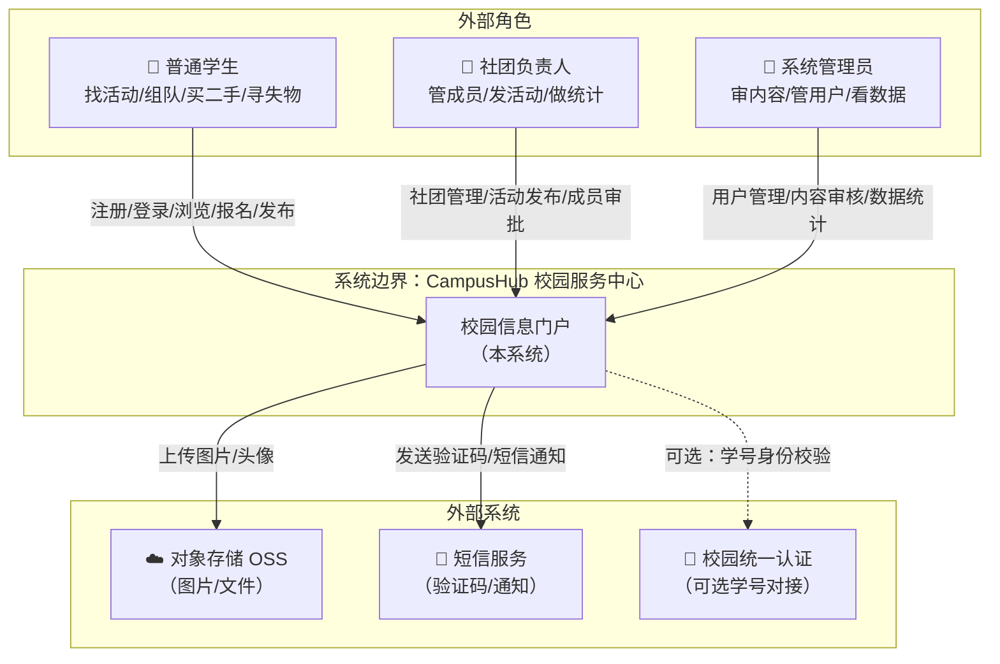

# 逻辑视图 L1：系统上下文图（C4-Context）

> 编号：L1 · 所属视图：逻辑视图 · 绘制日期：2026-10-27
> 用途：标明系统边界、外部用户角色、外部系统

---

## 1. 图

## 2. 文字解读

**系统边界**：CampusHub 是一个面向校园的综合信息服务系统，提供社团、竞赛、活动、二手、失物等 9 大模块的一站式服务，解决学生信息分散、报名混乱、交易不安全三大痛点。

**外部角色（3 类）**：
| 角色 | 主要交互 | 权限差异 |
|------|----------|----------|
| 普通学生 | 注册登录、浏览信息、活动报名、二手发布、失物认领 | 基础数据读写（个人相关） |
| 社团负责人 | 社团管理、活动发布、成员审批、报名统计 | 社团数据管理（本社团范围） |
| 系统管理员 | 用户管理、内容审核、全站公告、数据看板 | 全系统数据管理 |

**外部系统（3 个）**：
1. **对象存储 OSS**：活动封面、商品图、头像等图片文件存储（本次实现可用本地磁盘替代，接口保持一致）
2. **短信服务**：注册验证码、活动提醒（本次实现先做站内消息，短信为扩展项）
3. **校园统一认证**：与学校学号体系对接（可选能力，本项目用自有账号体系，预留对接点）

**本次实现重点**：全部角色交互走自建账号体系（JWT 认证），外部系统仅 OSS 为必要依赖（本地化实现），短信与统一认证标记为"预留扩展"。
