# 逻辑视图 L2：功能结构图（模块树）

> 编号：L2 · 所属视图：逻辑视图 · 绘制日期：2026-10-27
> 用途：一级模块 ≥6 个，逐级分解到子功能；标注本次实现重点

---

## 1. 图

```mermaid
flowchart TB
    CH["CampusHub 校园服务中心"]:::root

    CH --> M1["M1 用户权限模块 ★"]
    M1 --> M11["注册（学号/手机号）"]
    M1 --> M12["登录 + JWT认证"]
    M1 --> M13["个人信息管理"]
    M1 --> M14["角色权限控制<br/>（学生/社长/管理员）"]

    CH --> M2["M2 社团管理模块 ★"]
    M2 --> M21["社团创建与审核"]
    M2 --> M22["成员管理（入社审批/移除）"]
    M2 --> M23["社团列表与搜索"]
    M2 --> M24["社团动态发布"]

    CH --> M3["M3 竞赛组队模块 ★"]
    M3 --> M31["竞赛信息发布"]
    M3 --> M32["队伍创建与招募"]
    M3 --> M33["加入队伍申请与审批"]
    M3 --> M34["队伍成员管理"]

    CH --> M4["M4 活动组织模块 ★"]
    M4 --> M41["活动创建与发布"]
    M4 --> M42["在线报名（名额递减）"]
    M4 --> M43["签到核销（二维码）"]
    M4 --> M44["状态流转<br/>（草稿→发布→报名→进行→结束）"]

    CH --> M5["M5 信息推送模块 ★"]
    M5 --> M51["系统公告发布"]
    M5 --> M52["站内消息通知"]
    M5 --> M53["已读/未读管理"]
    M5 --> M54["消息分类筛选"]

    CH --> M6["M6 二手闲置模块 ★"]
    M6 --> M61["商品发布"]
    M6 --> M62["浏览与搜索"]
    M6 --> M63["状态流转<br/>（在售→预订→售出）"]
    M6 --> M64["收藏与评论"]

    CH --> M7["M7 失物招领模块 ★"]
    M7 --> M71["失物/招领发布"]
    M7 --> M72["认领申请与审核"]
    M7 --> M73["状态流转（待认领→已解决）"]
    M7 --> M74["按地点/时间筛选"]

    CH --> M8["M8 数据看板模块 ★"]
    M8 --> M81["用户统计（总数/日活/趋势）"]
    M8 --> M82["活动数据（参与率/热门）"]
    M8 --> M83["交易数据（成交量/分类）"]
    M8 --> M84["可视化图表"]

    CH --> M9["M9 文件管理模块 ★"]
    M9 --> M91["图片上传（封面/商品图/头像）"]
    M9 --> M92["文件存储与URL返回"]
    M9 --> M93["类型/大小校验"]
    M9 --> M94["文件列表管理"]

    classDef root fill:#667eea,color:#fff,stroke:#5a67d8
    classDef star fill:#eef2ff,stroke:#667eea
    class CH root
    class M1,M2,M3,M4,M5,M6,M7,M8,M9 star
```

## 2. 文字解读

**结构说明**：系统按业务领域划分为 **9 个一级模块**（满足个人任务 ≥6 个的要求），每个模块分解为 4 个子功能（满足每个模块 ≥3 个子功能的要求），共 **36 个子功能**。

| 模块 | 归属业务域 | 核心价值 | 实现优先级 |
|------|-----------|----------|-----------|
| M1 用户权限 | 基础域 | 全系统入口与权限基石 | P0（已实现） |
| M2 社团管理 | 组织域 | 社团数字化管理 | P1 |
| M3 竞赛组队 | 学业域 | 竞赛信息聚合+组队 | P1 |
| M4 活动组织 | 组织域 | 报名/签到/统计闭环 | P1 |
| M5 信息推送 | 支撑域 | 消息触达与已读管理 | P1 |
| M6 二手闲置 | 交易域 | 校园安全交易 | P1 |
| M7 失物招领 | 生活域 | 失物闭环找回 | P1 |
| M8 数据看板 | 管理域 | 运营决策可视化 | P2 |
| M9 文件管理 | 基础域 | 全系统图片/文件支撑 | P0（先做本地存储） |

**模块间依赖关系（重点）**：
- M1 是全局基础（所有模块依赖用户身份与权限）
- M9 是全局支撑（M2/M4/M6 的图片上传依赖它）
- M5 依赖 M2/M3/M4/M6/M7 产生消息事件
- M8 依赖 M1/M2/M4/M6 的统计数据
- M2/M3/M4 之间通过 M5 解耦（事件驱动，避免循环依赖）

**本次实现重点标注（★）**：9 个模块全部为实现范围；其中 M1、M9 为 P0 基础先行实现，M2-M7 为 P1 核心业务（检查点3 前完成），M8 为 P2 收尾（统计依赖业务数据）。
