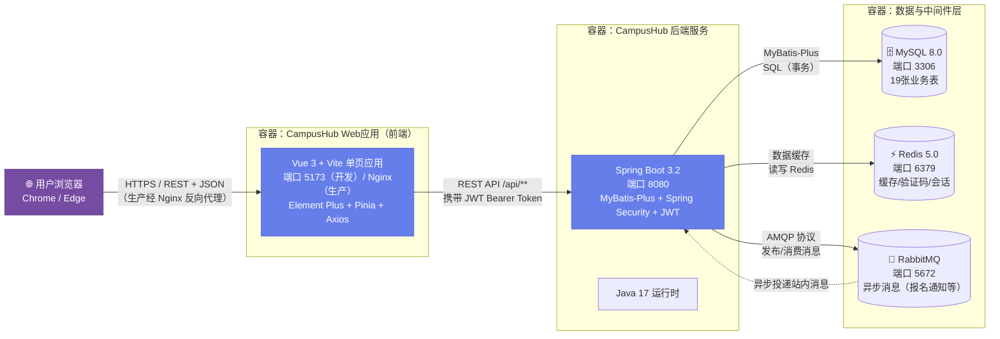

# 逻辑视图 L3：容器图（C4-Container）

> 编号：L3 · 所属视图：逻辑视图 · 绘制日期：2026-10-27
> 用途：展示系统的高层容器（前后端 + 中间件）及通信方式

---

## 1. 图

## 2. 文字解读

**容器划分**：系统由 4 类容器组成 —— 用户浏览器（客户端）、前端单页应用、后端服务、数据与中间件层。

| 容器 | 技术 | 端口 | 职责 |
|------|------|------|------|
| 前端 SPA | Vue 3 + Vite + Element Plus | 5173（开发） | 页面渲染、交互、路由、状态管理 |
| 后端服务 | Spring Boot 3.2 + MyBatis-Plus | 8080 | REST API、业务逻辑、认证鉴权 |
| MySQL | 8.0 | 3306 | 业务数据持久化（19张表） |
| Redis | 5.0 | 6379 | 缓存热点数据、验证码、登录会话 |
| RabbitMQ | 3.12 | 5672 | 异步消息（活动报名通知、站内消息） |

**关键通信链路**：
1. **请求链路**：浏览器 → 前端(5173/Nginx) → 后端(8080, JWT鉴权) → MySQL
2. **缓存链路**：后端 → Redis（热点数据如社团列表、商品列表，缓解DB压力）
3. **异步链路**：后端 → RabbitMQ（报名事件）→ 消费者 → 站内消息/通知（解耦+削峰）
4. **开发代理**：Vite dev server 将 `/api` 代理到 `localhost:8080`（已配置）

**与五视图的对应**：
- 逻辑视图的 9 个模块在容器层面**全部落在后端服务的模块分包**（modules/）中
- 状态机（C2复杂度）在后端模块内实现（如活动状态枚举+流转校验）
- 异步消息（C3复杂度）由 RabbitMQ 容器承载
- 容器图将在物理视图（P1）中进一步映射到部署节点
