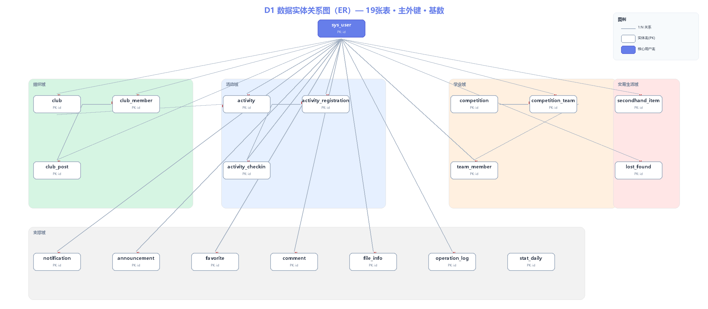

# 数据视图 D1：数据实体关系图（ER图）

> 编号：D1 · 所属视图：数据视图 · 绘制日期：2026-10-27
> 说明：19 张表实体关系，主外键与基数关系（满足 ≥10 实体要求）

---

## 1. 图



## 2. 实体清单与业务域

| 业务域 | 表 | 说明 |
|--------|-----|------|
| 核心 | sys_user | 用户表（全系统身份与权限基石） |
| 组织域 | club / club_member / club_post | 社团、成员关系、社团动态 |
| 活动域 | activity / activity_registration / activity_checkin | 活动、报名、签到 |
| 学业域 | competition / competition_team / team_member | 竞赛、队伍、队员 |
| 交易生活域 | secondhand_item / lost_found | 二手商品、失物招领 |
| 支撑域 | notification / announcement / favorite / comment / file_info / operation_log / stat_daily | 消息、公告、收藏、评论、文件、日志、统计 |

## 3. 核心关系（基数标注）

**以 sys_user 为中心的一对多辐射**：
```
sys_user 1 ─── N club            （leader_id 社长）
sys_user 1 ─── N club_member     （user_id 成员）
sys_user 1 ─── N club_post       （user_id 发布人）
sys_user 1 ─── N activity        （organizer_id 组织者）
sys_user 1 ─── N activity_registration（user_id 报名人）
sys_user 1 ─── N activity_checkin（user_id 签到人）
sys_user 1 ─── N competition_team（leader_id 队长）
sys_user 1 ─── N team_member     （user_id 队员）
sys_user 1 ─── N secondhand_item （seller_id 卖家 / buyer_id 买家）
sys_user 1 ─── N lost_found      （publisher_id 发布人 / finder_id 认领人）
sys_user 1 ─── N notification / announcement / favorite / comment / file_info / operation_log
```

**域内级联关系**：
```
club 1 ─── N club_member（club_id）
club 1 ─── N club_post（club_id）
club 1 ─── N activity（club_id 社团发起）
activity 1 ─── N activity_registration（activity_id）
activity 1 ─── N activity_checkin（activity_id）
competition 1 ─── N competition_team（competition_id）
competition_team 1 ─── N team_member（team_id）
```

## 4. 设计要点说明

1. **状态机字段用 VARCHAR 枚举**：5 个核心状态机（活动5状态/社团4状态/二手4状态/失物3状态/竞赛4状态）均以 status 字段 + 代码层流转校验实现，满足 C2 复杂度
2. **唯一键防并发**：4 个 uk_ 唯一键保证"一人一社/一人一队/一人一报/收藏去重"，防止并发重复操作
3. **多态外键**：favorite、comment 用 target_type + target_id 指向不同业务对象（逻辑外键，代码层校验），避免物理外键跨表性能损耗
4. **统计宽表**：stat_daily 每日一行（uk_date），支撑 M8 数据看板，避免实时聚合大表
5. **乐观锁预留**：activity.current_participants 报名扣减用 MyBatis-Plus @Version 乐观锁（配合 ADR-004 Redis 原子计数），防超卖
