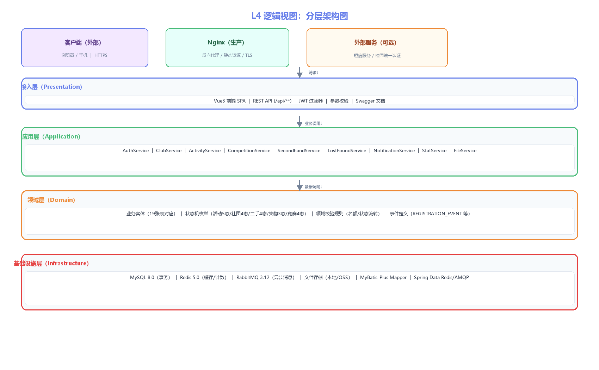

# 逻辑视图 L4：分层架构图

> 编号：L4 · 所属视图：逻辑视图 · 绘制日期：2026-10-27
> 用途：展示接入层/应用层/领域层/基础设施层的分层架构

---

## 1. 图



## 2. 文字解读

**架构风格**：经典分层架构（Presentation → Application → Domain → Infrastructure），层间单向依赖，上层依赖下层接口，禁止跨层调用与反向依赖。整体采用**领域驱动思想组织模块**（每个业务域一个 Service + 实体 + Mapper），满足任务书"分层架构 + 无循环依赖"要求（L8 模块依赖矩阵待第7周补充验证）。

| 层 | 职责 | 组件 |
|----|------|------|
| 接入层 | 请求入口、认证、参数校验、接口文档 | Vue3 SPA、REST API（/api/**）、JWT过滤器、Validation、Swagger |
| 应用层 | 业务用例编排、事务边界、模块间协作 | AuthService、ClubService、ActivityService、CompetitionService、SecondhandService、LostFoundService、NotificationService、StatService、FileService |
| 领域层 | 业务规则、状态机、实体与事件 | 19张表对应实体、5个状态机枚举、领域校验（名额/流转）、领域事件（REGISTRATION_EVENT） |
| 基础设施层 | 数据持久化、缓存、消息、文件 | MySQL（事务）、Redis（缓存/计数）、RabbitMQ（异步）、文件存储、MyBatis-Plus Mapper、Spring Data Redis/AMQP |

**外部依赖**：客户端（浏览器/手机）、Nginx（生产反向代理+静态资源）、短信服务与校园统一认证（可选扩展，预留接口）。

**依赖方向**（严格自上而下）：
```
请求 → 接入层 → 应用层 → 领域层 → 基础设施层
                                   ↓
                          MySQL / Redis / RabbitMQ / 文件
```

**与代码的对应**：后端源码 `com.campushub` 包结构 = 接入层（controller）→ 应用层（service）→ 领域层（entity/dto/vo/enums）→ 基础设施层（mapper/config），目录与分层一一对应（第7周 V2 源码目录图验证）。
