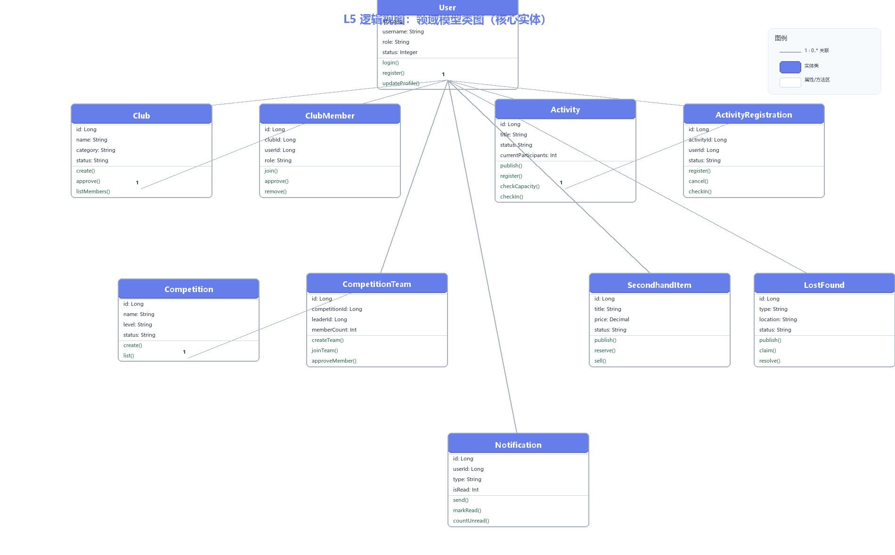

# 逻辑视图 L5：领域模型类图

> 编号：L5 · 所属视图：逻辑视图 · 绘制日期：2026-10-27
> 用途：核心实体类及关系（≥8个实体，满足要求）

---

## 1. 图



## 2. 文字解读

**10 个核心实体类**（对应数据库 19 张表的核心域）：

| 实体 | 关键属性 | 关键方法 | 所属模块 |
|------|----------|----------|----------|
| User | id, username, role, status | login(), register(), updateProfile() | M1 用户权限 |
| Club | id, name, category, status | create(), approve(), listMembers() | M2 社团管理 |
| ClubMember | clubId, userId, role | join(), approve(), remove() | M2 社团管理 |
| Activity | id, title, status, currentParticipants | publish(), register(), checkCapacity(), checkIn() | M4 活动组织 |
| ActivityRegistration | activityId, userId, status | register(), cancel(), checkIn() | M4 活动组织 |
| Competition | id, name, level, status | create(), list() | M3 竞赛组队 |
| CompetitionTeam | competitionId, leaderId, memberCount | createTeam(), joinTeam(), approveMember() | M3 竞赛组队 |
| SecondhandItem | id, title, price, status | publish(), reserve(), sell() | M6 二手闲置 |
| LostFound | id, type, location, status | publish(), claim(), resolve() | M7 失物招领 |
| Notification | userId, type, isRead | send(), markRead(), countUnread() | M5 信息推送 |

**关联关系（1 : 0..*）**：
```
User 1 ─── 0..* Club（leader_id 社长）
User 1 ─── 0..* ClubMember（成员）
Club 1 ─── 0..* ClubMember（club_id）
User 1 ─── 0..* Activity（organizer_id 组织者）
Activity 1 ─── 0..* ActivityRegistration（activity_id）
User 1 ─── 0..* ActivityRegistration（user_id）
User 1 ─── 0..* CompetitionTeam（leader_id 队长）
Competition 1 ─── 0..* CompetitionTeam（competition_id）
User 1 ─── 0..* SecondhandItem（seller_id）
User 1 ─── 0..* LostFound（publisher_id）
User 1 ─── 0..* Notification（user_id）
```

**设计说明**：
1. **状态字段作为实体属性**：status 属性 + 枚举校验实现状态机（C2 复杂度），如 Activity.status 六态流转
2. **报名/成员关系用关系实体**：ClubMember、ActivityRegistration、CompetitionTeam 作为中间实体承载状态与唯一约束（uk_*）
3. **多态关联**：favorite、comment 通过 targetType + targetId 关联多类对象（未在类图展开，见 D2 数据字典）
4. **方法归属**：领域行为（checkCapacity、checkIn、approveMember）放在实体/领域服务中，应用层仅做编排——体现领域层业务规则内聚
