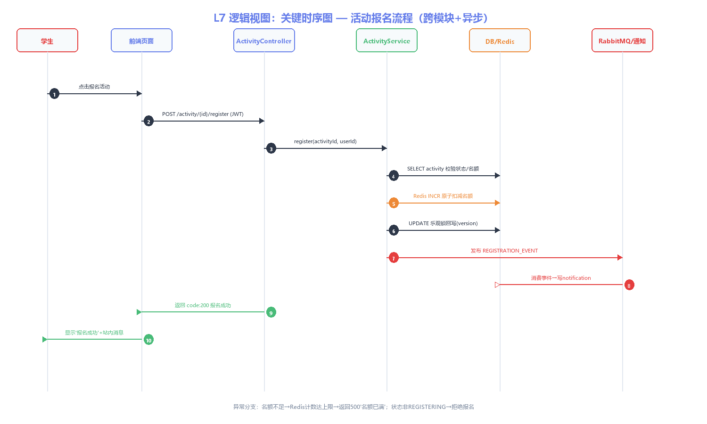
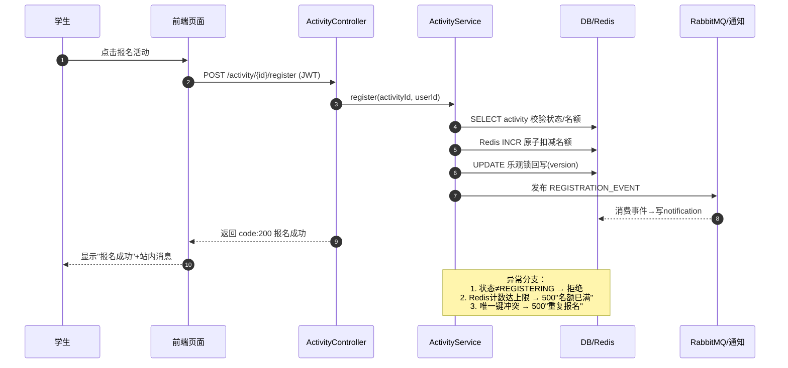
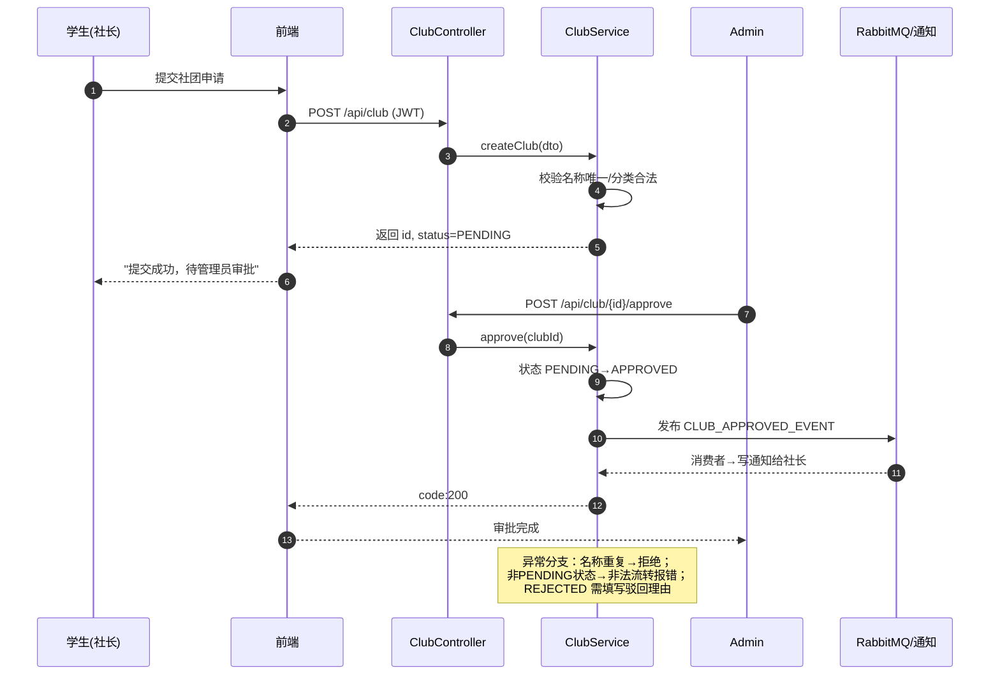
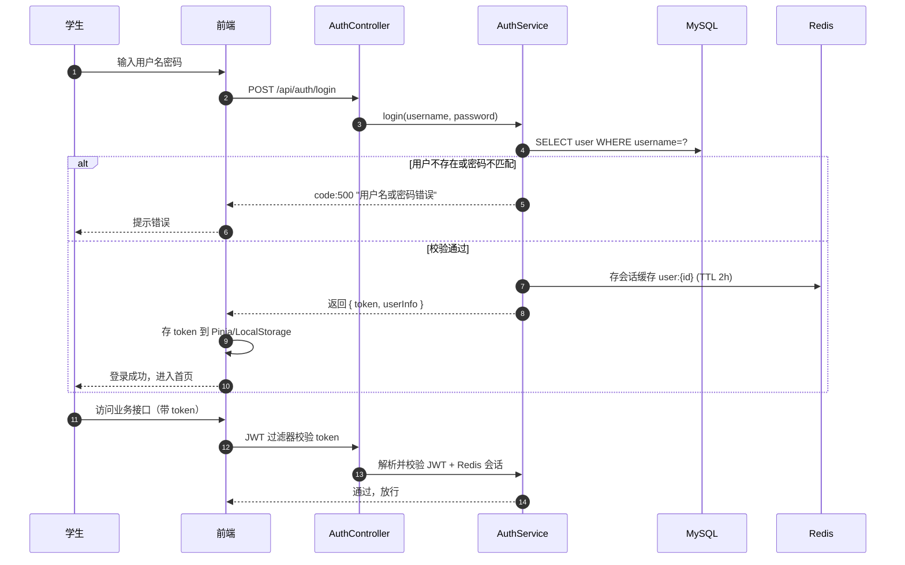

# 逻辑视图 L7：关键时序图

> 编号：L7 · 所属视图：逻辑视图 · 绘制日期：2026-10-27
> 用途：跨模块关键流程时序（≥3个：跨模块调用/异步消息/异常分支）

---

## 1. 时序图一：活动报名流程（跨模块 + 异步消息 + 异常分支）

**Mermaid 源码（可复现）**：

**流程说明**：
1. 前端带 JWT 调用报名接口（第2步），Controller 只做参数校验
2. ActivityService 校验活动状态（必须 REGISTERING）与名额（第4步）
3. **Redis INCR 原子扣减**（第5步）：利用 Redis 单线程特性防并发超卖，扣到上限即拒绝
4. **乐观锁回写**（第6步）：`UPDATE ... WHERE version=?` 失败则重试（结合 ADR-004）
5. **异步通知**（第7-8步）：报名事务提交后发布 REGISTRATION_EVENT 到 RabbitMQ，通知消费者异步写站内消息——**报名接口不阻塞等通知，解耦且提升吞吐**
6. 前端轮询/即时返回结果（第9-10步）

---

## 2. 时序图二：社团创建与审批流程（状态机 C2）

**说明**：演示**管理员审批流状态机**（PENDING→APPROVED/REJECTED），审核结果通过异步消息通知申请人——体现角色权限（C1）与异步通知。

---

## 3. 时序图三：用户登录认证流程（JWT + Redis 会话）

**说明**：登录 = MD5 校验密码 + 签发 JWT（2小时）+ Redis 缓存会话状态；后续请求经 JWT 过滤器（Spring Security 放行 /auth/**，其余校验）——对应 ADR-005 认证授权设计。

---

## 4. 时序图覆盖矩阵

| 场景 | 覆盖内容 | 满足的复杂度项 |
|------|----------|----------------|
| 活动报名 | 跨模块调用 + 异步消息 + Redis 并发 + 异常分支 | C2 状态机、C3 并发、C4 异步 |
| 社团审批 | 多角色权限 + 状态机流转 + 异步通知 | C1 角色权限、C2 状态机 |
| 登录认证 | 外部系统交互 + 缓存会话 + 失败分支 | C1 认证、C3 性能 |
