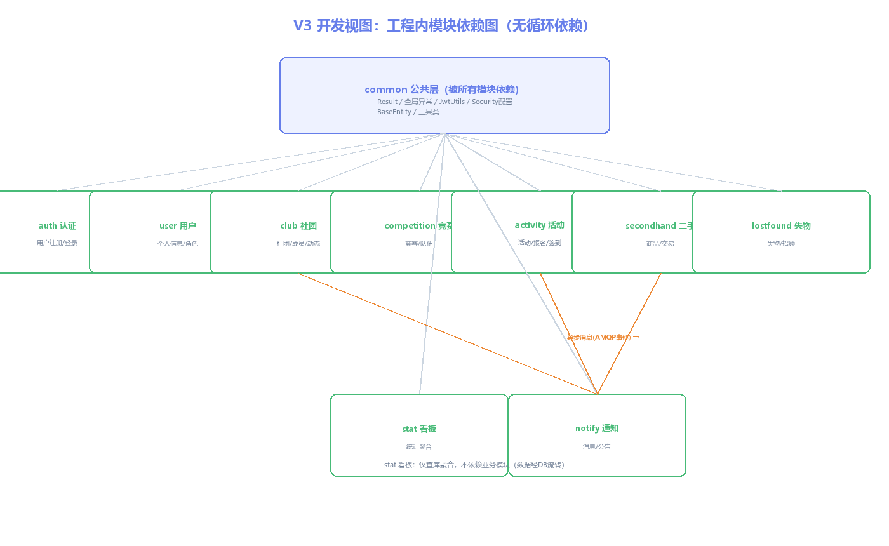

# 开发视图：V1~V8 开发视角设计

> 所属视图：开发视图 · 绘制日期：2026-10-27
> 覆盖：V1 技术栈选型 / V2 源码目录结构 / V3 模块依赖图 / V4 第三方依赖清单 / V5 配置与环境管理 / V7 编码规范 / V8 版本管理策略

---

## V1 技术栈选型表

| 层次 | 技术 | 版本 | 选型理由 | 被否决备选 |
|------|------|------|----------|------------|
| 语言 | Java | 17 | 长期支持、Spring Boot 3 基线 | Java 8（过老）/ Kotlin（团队不熟） |
| 后端框架 | Spring Boot | 3.2.5 | 生态成熟、约定大于配置 | Spring Boot 2（无新特性）/ Quarkus（国内资料少） |
| 持久层 | MyBatis-Plus | 3.5.5 | 单表 CRUD 免写 SQL、学习成本低 | JPA（复杂查询不直观）/ 原生 MyBatis（样板代码多） |
| 数据库 | MySQL | 8.0 | 主流、事务/索引成熟、本机已装 | PostgreSQL（本机未装）/ SQLite（不支持高并发） |
| 缓存 | Redis | 5.0 | 原子操作支撑并发报名计数 | Memcached（无原子计数扩展）/ 本地缓存（不共享） |
| 消息队列 | RabbitMQ | 3.12 | 可靠投递+死信，满足异步复杂度 C4 | Kafka（个人项目过重）/ ActiveMQ（生态弱） |
| 鉴权 | JWT (jjwt) | 0.12.6 | 无状态、跨端 | Spring Security OAuth2（过重） |
| 前端框架 | Vue | 3.x | 组合式 API 现代化、社区大 | React（个人更熟 Vue）/ jQuery（淘汰） |
| 前端构建 | Vite | 5.x | 秒级热更新 | Webpack（配置繁琐）/ CRA（老旧） |
| UI 组件 | Element Plus | 2.x | 后台管理界面开箱即用 | Ant Design Vue（风格不符）/ Naive UI（生态小） |
| 状态管理 | Pinia | 2.x | Vue3 官方推荐、TS 友好 | Vuex（已过渡）/ 全局变量（不可维护） |
| 接口文档 | SpringDoc | 2.3.0 | 自动生成 OpenAPI3 | Knife4j（依赖重） |
| 部署 | Docker Compose | - | 一键复现部署 | 云主机裸部署（不可复现） |
| IDE | IDEA / VS Code | 2024.1 / 最新 | 后端/前端分 IDE | Eclipse（体验差） |
| 构建工具 | Maven | 3.9.7 | 国内镜像成熟 | Gradle（学习成本高） |

---

## V2 源码目录结构

```
CampusHub/
├── backend/                          # 后端 Spring Boot 3（端口8080，context-path=/api）
│   ├── pom.xml                       # Maven 依赖（MyBatis-Plus/JWT/Redis/RabbitMQ/SpringDoc）
│   └── src/main/
│       ├── java/com/campushub/
│       │   ├── CampusHubApplication.java      # 启动类
│       │   ├── common/                        # 公共层（被所有模块依赖，ADR-008）
│       │   │   ├── Result.java                # 统一响应 {code,message,data}
│       │   │   ├── GlobalExceptionHandler.java# 全局异常
│       │   │   ├── JwtUtils.java              # JWT 生成/解析（HS384）
│       │   │   ├── SecurityConfig.java        # Spring Security 过滤链（放行/auth/**等）
│       │   │   └── BaseEntity.java            # id/createTime/updateTime
│       │   └── modules/                       # 业务模块（每模块四层）
│       │       ├── auth/    AuthController/Service/Mapper/User
│       │       ├── user/
│       │       ├── club/    ClubController/Service/Mapper/Club/ClubMember/ClubPost
│       │       ├── competition/ Competition/CompetitionTeam/TeamMember
│       │       ├── activity/ Activity/ActivityRegistration/ActivityCheckin
│       │       ├── secondhand/ SecondhandItem
│       │       ├── lostfound/ LostFound
│       │       ├── notify/   Notification/Announcement
│       │       └── stat/     StatDaily
│       └── resources/
│           ├── application.yml               # 开发配置（MySQL/Redis/RabbitMQ/JWT）
│           ├── application-prod.yml          # 生产配置（占位，第13周填充）
│           └── mapper/                        # MyBatis XML（复杂SQL）
├── frontend/                         # 前端 Vue3 + Vite5（端口5173，代理→8080）
│   ├── src/
│   │   ├── api/       user.js 等接口封装
│   │   ├── views/     Login.vue / Register.vue / ClubList.vue / ActivityList.vue ...
│   │   ├── router/    index.js 路由
│   │   ├── stores/    Pinia（user 状态）
│   │   ├── utils/     request.js（Axios拦截器，带Token）
│   │   └── layouts/   MainLayout.vue（侧边栏+顶栏）
│   └── vite.config.js                # 代理配置 5173→8080
└── docs/
    ├── 需求规格说明书.md
    ├── sql/init.sql                  # 19张表建表脚本
    └── architecture/                 # 五视图文档 + adr/ + images/ + draw*.py
```

---

## V3 模块依赖图



**依赖规则**：
1. 所有业务模块依赖 `common` 公共层（单向，无反向）
2. 业务模块间**不直接 import**：`activity/club/secondhand → notify` 通过 RabbitMQ 领域事件解耦（ADR-006）
3. `stat` 看板只查询数据库聚合，不依赖业务模块 API
4. 依赖方向：`modules/xxx → common`，无循环依赖（编译期可通过 `jdeps` / IDE 依赖分析验证）

---

## V4 第三方依赖清单（Maven 直接依赖）

| 依赖 | 版本 | 用途 | 许可证 |
|------|------|------|--------|
| spring-boot-starter-web | 3.2.5 | Web/内嵌Tomcat | Apache-2.0 |
| spring-boot-starter-security | 3.2.5 | 认证授权 | Apache-2.0 |
| spring-boot-starter-data-redis | 3.2.5 | Redis 缓存 | Apache-2.0 |
| spring-boot-starter-amqp | 3.2.5 | RabbitMQ 消息 | Apache-2.0 |
| mybatis-plus-spring-boot3-starter | 3.5.5 | ORM 单表CRUD | Apache-2.0 |
| mysql-connector-j | 8.x | MySQL 驱动 | GPL-2.0 |
| jjwt-api / jjwt-impl / jjwt-jackson | 0.12.6 | JWT 令牌 | Apache-2.0 |
| springdoc-openapi-starter-webmvc-ui | 2.3.0 | Swagger 接口文档 | Apache-2.0 |
| lombok | 1.18.x | 简化实体代码 | MIT |
| spring-boot-starter-validation | 3.2.5 | 参数校验 | Apache-2.0 |
| spring-boot-starter-test | 3.2.5 | 单元测试 | Apache-2.0 |

---

## V5 配置与环境管理

| 配置项 | 开发（application.yml） | 生产（application-prod.yml，第13周） |
|--------|------------------------|--------------------------------------|
| 数据库 | `jdbc:mysql://localhost:3306/campus_hub` root/123456 | 占位：环境变量注入 `${DB_HOST}/${DB_PASSWORD}` |
| Redis | localhost:6379 | `${REDIS_HOST}:6379` |
| RabbitMQ | localhost:5672 guest/guest | `${MQ_HOST}:5672` + 专用账号 |
| JWT 密钥 | 开发固定密钥（仅本地） | 环境变量 `${JWT_SECRET}` 注入，≥64字符 |
| 文件上传 | 本地目录 `./uploads` | OSS 或 NFS 挂载（占位） |
| 日志 | 控制台 + info 级别 | logback 滚动文件，warn 告警 |
| CORS | 允许 localhost:5173 | 仅允许域名（Nginx 同源） |

**密钥管理原则**：密码/密钥不写入代码与 Git，生产用环境变量注入；开发默认值仅限本地。

---

## V7 编码规范

**命名**：
- 类：PascalCase；`XxxController/XxxService/XxxMapper/Xxx`（实体）
- 方法/变量：camelCase；`register/create/update/delete/query`
- 常量：UPPER_SNAKE_CASE；状态枚举：`ActivityStatus.REGISTERING`
- 表字段：snake_case；代码字段：camelCase（MyBatis-Plus 自动映射）

**异常**：
- 业务异常抛 `BusinessException(message)`，全局处理器转 Result(code:500)
- 禁止吞异常；禁止 `catch(Exception)` 空处理

**日志**：
- 用 SLF4J `log.info/warn/error`；入口方法 info 记录入参，异常处 error 记录堆栈
- 不打印密码等敏感信息

**注释**：
- 类注释：用途一句话；关键方法 Javadoc 说明入参/返回/异常
- 状态流转处注释合法流转

**SQL**：
- 单表 CRUD 用 MyBatis-Plus 方法；多表/复杂查询写 XML 并命名 `XxxMapper.xml`

---

## V8 版本管理策略（Git）

**分支模型**（轻量 Git Flow，个人项目简化）：
```
main（稳定，可演示）
  └─ feature/xxx（功能分支，完成合并）
  └─ docs/xxx（文档分支，五视图/ADR）
```

**提交信息规范**：
```
<type>: <subject>

type: feat(功能)/fix(修复)/docs(文档)/style(格式)/refactor(重构)/test(测试)
示例：feat: 实现活动报名接口 / docs: 补ADR-005认证授权
```

**实践**：
- 每周日晚 20:00 定时任务自动 `git add -A && commit && push`（SSH over 443 通道）
- 核心标记：`git tag v0.1`（第6周骨架）、`v0.2`（第11周核心模块）、`v0.3`（第13周全功能）
- 历史提交：6803667 骨架 → 4d39451 前端初始化 → e27258f 第4周 → 90ca955 第5周前端 → ee45ee7 第5周视图 → c0f9da4 第6周数据 → befaaaf 第6周L4-L7（→ 本次提交开发/运行/物理视图）
