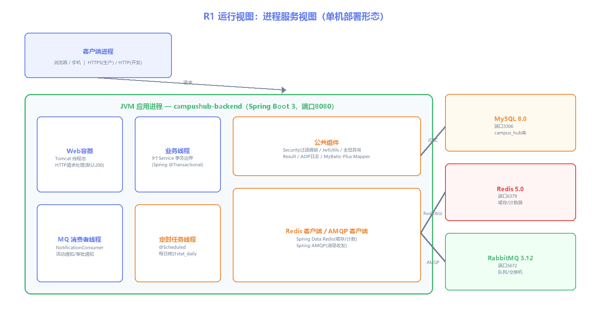
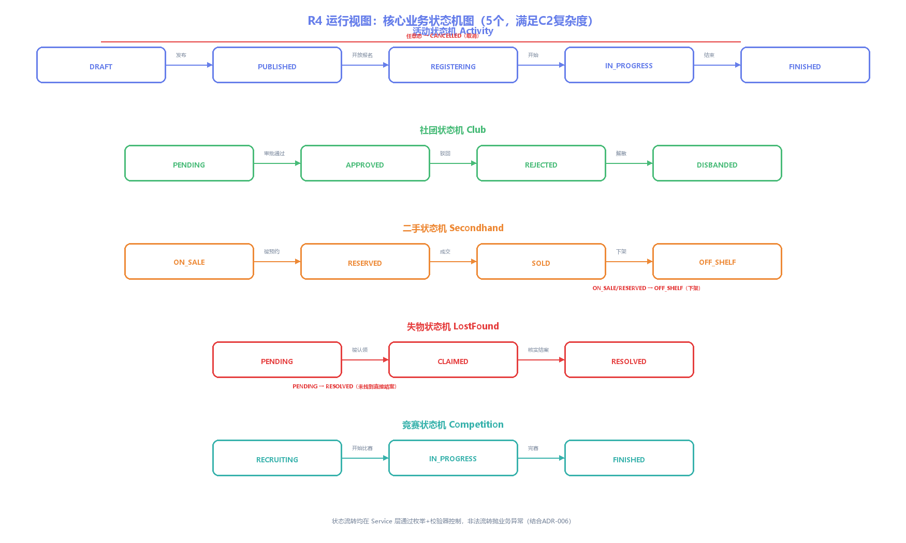

# 运行视图：R1~R7 运行视角设计

> 所属视图：运行视图 · 绘制日期：2026-10-27
> 覆盖：R1 进程服务视图 / R2 并发线程模型 / R4 状态机图 / R5 消息设计 / R6 性能容量估算 / R7 并发控制

---

## R1 进程服务视图



**单机运行形态**（与开发环境一致，部署见 P1）：
- **1 个 JVM 应用进程**：Web 容器（Tomcat 线程池，默认 max=200）+ 9 个业务 Service + MQ 消费者线程（通知）+ @Scheduled 定时任务线程（每日统计）
- **3 个基础设施进程**：MySQL（3306）、Redis（6379）、RabbitMQ（5672）
- 请求链路：客户端 → Web容器 → 业务线程（事务）→ 基础设施；异步链路：事务提交 → 发布事件 → MQ 消费者线程写通知

---

## R2 并发线程模型

| 场景 | 线程模型 | 配置 |
|------|----------|------|
| HTTP 请求处理 | Tomcat 默认线程池，每个请求一个工作线程，业务在 Service 事务内 | `server.tomcat.threads.max: 200` |
| 数据库连接 | HikariCP 连接池，事务期间独占连接 | `maximum-pool-size: 20` |
| 缓存操作 | Redis 客户端线程（Spring Data Redis），原子命令无需锁 | - |
| 消息消费 | RabbitMQ 消费者线程池，每条消息一个消费任务，处理完手动 ACK | 默认并发 8，可配 `concurrency: 4-16` |
| 定时任务 | @Scheduled 单线程调度器，`stat_daily` 每日 00:05 跑一次 | 默认单线程，任务无并发 |
| 活动报名热点 | **Web线程并发扣减 Redis 计数**（INCR 原子），DB 乐观锁兜底 | Redis 单线程原子性 |

**连接池/线程数估算**：DAU 约 500、峰值 QPS ~20（见 R6），200 线程 + 20 连接池完全足够。

---

## R4 核心业务状态机图



| 状态机 | 状态集 | 流转示例 | 复杂度 |
|--------|--------|----------|--------|
| 活动 Activity | DRAFT→PUBLISHED→REGISTERING→IN_PROGRESS→FINISHED；任意态可 CANCELLED | 创建草稿→发布→开放报名→开始→结束 | C2 ✅ |
| 社团 Club | PENDING→APPROVED/REJECTED→DISBANDED | 申请→管理员审批→运营→解散 | C2 ✅ |
| 二手 Secondhand | ON_SALE→RESERVED→SOLD；ON_SALE/RESERVED→OFF_SHELF | 上架→被预约→成交/下架 | C2 ✅ |
| 失物 LostFound | PENDING→CLAIMED→RESOLVED | 发布→被认领→核实结案 | C2 ✅ |
| 竞赛 Competition | RECRUITING→IN_PROGRESS→FINISHED | 招募→开赛→完赛 | C2 ✅ |

**实现**：每个状态机一个枚举 + Service 层流转校验器，非法流转抛 `BusinessException("状态不允许流转")`。

---

## R5 消息设计（RabbitMQ）

**交换机/队列拓扑**（Direct 模式）：
```
campushub.exchange (Direct)
  ├── queue.campus.registration ← REGISTRATION_EVENT（活动报名）
  ├── queue.campus.club         ← CLUB_APPROVED_EVENT（社团审批）
  └── queue.campus.trade        ← TRADE_EVENT（二手成交）
       └── DLX: campushub.dlx（死信队列，重试3次后进入，人工排查）
```

| 事件 | 生产者 | 消费者 | 载荷 | 用途 |
|------|--------|--------|------|------|
| REGISTRATION_EVENT | ActivityService（事务提交后） | NotificationConsumer | {activityId, userId, title} | 写站内消息"报名成功" |
| CLUB_APPROVED_EVENT | ClubService（审批后） | NotificationConsumer | {clubId, leaderId, status, reason} | 通知社长审批结果 |
| TRADE_EVENT | SecondhandService（成交后） | NotificationConsumer | {itemId, sellerId, buyerId} | 通知买卖双方 |

**可靠性**：队列/消息持久化（durable）；消费手动 ACK；失败重试 3 次（指数退避）→ 死信；消费幂等（事件ID去重）。

---

## R6 性能容量估算

**规模假设**（校园场景，长春理工在校约 2 万学生，取活跃 2.5%）：

| 指标 | 假设 | 估算值 |
|------|------|--------|
| 日活 DAU | 在校生 2万 × 2.5% | ~500 人/日 |
| 峰值在线 | DAU × 30% 同时在线 | ~150 并发在线 |
| 单用户操作频率 | 平均 5 次/日 | 2,500 次/日 |
| 日均 QPS | 2500 / (8h×3600) | ~0.09 QPS |
| 峰值 QPS | 平均 × 20 倍（报名开放瞬间） | ~2 QPS（峰值 20） |
| 报名热点 | 单活动报名瞬间 | 100 并发请求，Redis INCR 原子处理 |

**资源核算**：
- Tomcat 200 线程 ≫ 峰值 20 QPS，无瓶颈
- HikariCP 20 连接 ≫ 需要（每次事务占用 <50ms）
- MySQL：单表 <10 万行，索引覆盖查询 <10ms
- Redis 内存：缓存 ~1MB（验证码+热点计数），忽略不计
- **结论**：单机部署性能富余 10 倍以上，无需集群；扩容路径 = 多副本 + Nginx（P1）

---

## R7 并发控制与幂等

| 场景 | 手段 | 说明 |
|------|------|------|
| 活动报名抢名额 | **Redis INCR 原子计数** | `INCR activity:count:{id}` 达上限即拒绝，杜绝超卖 |
| 报名落库 | **MyBatis-Plus 乐观锁**（@Version） | `UPDATE ... SET version=version+1 WHERE version=?`，冲突重试 |
| 一人一报 | 唯一键 `uk_activity_user` | 重复报名触发唯一键异常 → 友好提示 |
| 一人一社/一队 | 唯一键 `uk_club_user` / `uk_team_user` | 幂等加入 |
| 收藏去重 | 唯一键 `uk_user_type_target` | 幂等收藏 |
| 消息消费 | 事件ID 幂等表 | 重复投递不重复写通知 |
| 签到核销 | 唯一键 + 状态校验 | 已签到不可重复签到 |

**分布式锁（可选增强）**：跨进程临界区（如"审批+解散"并发）用 Redis `SETNX` 锁，见 ADR-004 扩展。
