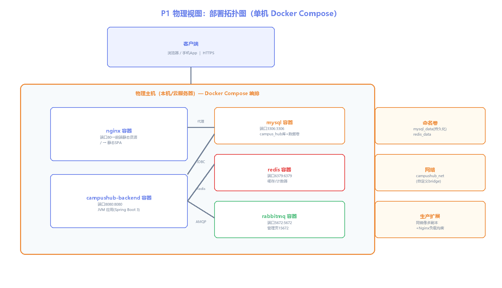

# 物理视图：P1 部署拓扑 + P4 Docker Compose

> 所属视图：物理视图 · 绘制日期：2026-10-27
> 覆盖：P1 部署拓扑图 / P4 Docker Compose 编排（交付物）

---

## P1 部署拓扑图



**部署形态**：单主机 Docker Compose 编排 5 个容器（ADR-007）：
- `nginx`：80 端口，托管前端静态资源 + 反向代理 `/api` → backend
- `campushub-backend`：8080，Spring Boot 3 JVM 应用
- `mysql`：3306，campus_hub 库，数据持久化到命名卷 `mysql_data`
- `redis`：6379，缓存与报名计数
- `rabbitmq`：5672 + 管理页 15672

**网络**：自定义 bridge 网络 `campushub_net`，容器间通过服务名通信（`mysql:3306`），外部仅暴露 80/8080。

---

## P4 Docker Compose（交付物文件：`docker-compose.yml`）

```yaml
version: "3.8"

services:
  mysql:
    image: mysql:8.0
    container_name: campushub-mysql
    environment:
      MYSQL_ROOT_PASSWORD: "123456"
      MYSQL_DATABASE: campus_hub
    ports:
      - "3306:3306"
    volumes:
      - mysql_data:/var/lib/mysql
    healthcheck:
      test: ["CMD", "mysqladmin", "ping", "-h", "localhost"]
      interval: 10s
      retries: 5

  redis:
    image: redis:5.0
    container_name: campushub-redis
    ports:
      - "6379:6379"
    volumes:
      - redis_data:/data

  rabbitmq:
    image: rabbitmq:3.12-management
    container_name: campushub-rabbitmq
    ports:
      - "5672:5672"
      - "15672:15672"
    volumes:
      - mq_data:/var/lib/rabbitmq

  backend:
    build: ./backend
    container_name: campushub-backend
    depends_on:
      mysql:
        condition: service_healthy
      redis:
        condition: service_started
      rabbitmq:
        condition: service_started
    environment:
      SPRING_PROFILES_ACTIVE: prod
      DB_HOST: mysql
      DB_PASSWORD: "123456"
      REDIS_HOST: redis
      MQ_HOST: rabbitmq
    ports:
      - "8080:8080"

  nginx:
    image: nginx:1.25-alpine
    container_name: campushub-nginx
    depends_on:
      - backend
    volumes:
      - ./frontend/dist:/usr/share/nginx/html:ro
      - ./nginx.conf:/etc/nginx/conf.d/default.conf:ro
    ports:
      - "80:80"

volumes:
  mysql_data:
  redis_data:
  mq_data:
```

> 文件位置：`CampusHub/docker-compose.yml`（正式交付时置于项目根目录；当前 07-环境配置脚本/ 下已有初版，最终版在集成周统一）
> 说明：本机已安装 MySQL/Redis/RabbitMQ 独立进程（开发用），Compose 用于部署/演示复现；Docker Desktop 曾因 WSL2 VHDX 错误无法启动（ADR-007 记录），本机演示回退本机进程，Compose 文件为交付物。

**验证**：`docker compose up -d` → `docker ps` 5 容器健康 → 访问 `http://localhost`（前端）+ `/api`（后端）。
